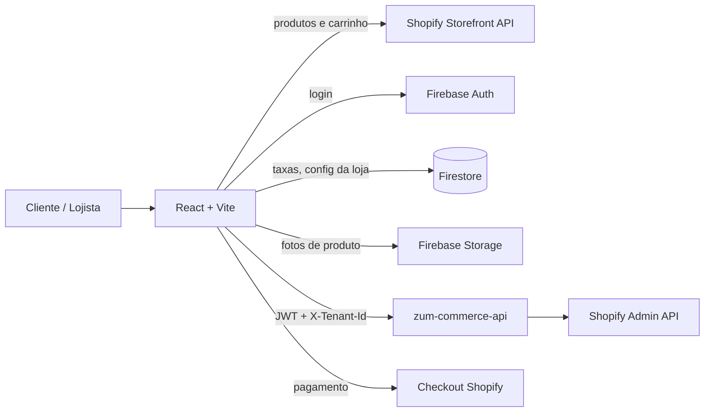

# Arquitetura do front-end

## Visão geral



- **Vitrine** (`/`): fala direto com a Storefront API usando o token público da loja. Esse token só permite ler a vitrine e montar carrinho.
- **Cadastro do cliente e painel** (`/admin`): passam pela API, que guarda as credenciais secretas da Shopify.
- **Multi-loja**: a vitrine descobre a loja pelo domínio (`domains/{host}` no Firestore). O painel lista as lojas que o usuário administra (`GET /api/me`).

## Estrutura de pastas

```text
zum-commerce/
├── README.md, ARCHITECTURE.md, ESCOPO_DO_PROJETO.md
├── iniciar-frontend.bat, iniciar-backend.bat
├── firebase.json                hosting + rewrite /api → Cloud Run
├── firestore.rules, storage.rules, firestore.indexes.json
└── frontend/
    ├── index.html
    ├── package.json             scripts e dependências
    ├── vite.config.ts, vitest.config.ts, eslint.config.js, .prettierrc, tsconfig.json
    ├── .env.example
    └── src/
        ├── main.tsx             entrada da aplicação
        ├── App.tsx              BrowserRouter + rotas
        ├── index.css            Tailwind + tokens da marca (--brand)
        ├── routes/              AppRoutes, StoreRoutes, AdminRoutes, paths
        ├── contexts/            TenantContext, AuthContext, CartContext, AdminContext
        ├── components/
        │   ├── atoms/           Alert, Field, Spinner, StatusBadge, WhatsAppButton
        │   ├── molecules/       ProductCard, QuantityStepper, SearchBar, RequireTenant, CenterMessage
        │   ├── organisms/       StoreHeader, StoreFooter, CartDrawer, LoginPanel, AdminHeader, FeeSimulator
        │   ├── templates/       StoreLayout, AdminLayout
        │   └── pages/
        │       ├── store/       Home, ProductPage, Login, Register, Checkout, Account
        │       └── admin/       AdminProducts, ProductForm, AdminCustomers, AdminFees, AdminPlatform
        ├── data/                textos e listas fixas (status de produto, campos de taxa, planos Shopify)
        ├── lib/                 api, firebase, storefront, tenant, fees, variants, richText, format, safeStorage (+ testes)
        └── types/               tipos compartilhados (espelham os contratos da API)
```

A organização segue **Atomic Design**: átomos sem regra de negócio → moléculas → organismos → templates (estrutura da página) → pages (telas ligadas a rotas). Só existem as pastas que têm código; nada de pastas reservadas vazias.

### Onde fica cada responsabilidade

| Precisa de… | Vai em |
|---|---|
| Chamar a API em C# | `lib/api.ts` (envia token do Firebase + `X-Tenant-Id`) |
| Ler produtos / carrinho da Shopify | `lib/storefront.ts` |
| Estado global (loja, login, carrinho, loja do painel) | `contexts/` |
| Cálculo de taxas, grade de variações, conversão de texto | `lib/fees.ts`, `lib/variants.ts`, `lib/richText.ts` (funções puras, testadas) |
| Listas e rótulos fixos | `data/` |
| Endereços de tela | `routes/paths.ts` |

## Fluxos principais

1. **Navegar e montar carrinho**: `TenantContext` resolve a loja, `StoreRoutes` monta a vitrine e `CartContext` cria/atualiza o carrinho na Shopify, com o id salvo em `localStorage` por loja.
2. **Compra só com cadastro**: em "Finalizar compra", sem login vai para `/entrar`. Logado mas sem cadastro na loja, vai para `/cadastro`, onde `POST /api/store/customers/register` cria o Customer na Shopify. Em `/checkout`, `cartBuyerIdentityUpdate` vincula o cliente ao carrinho e redireciona para o checkout da Shopify.
3. **Cadastro de produto**: em `ProductForm`, as fotos vão para o Firebase Storage, `lib/variants.ts` gera a grade de variações e `FeeSimulator` mostra o líquido por forma de pagamento. Ao salvar, `POST /api/admin/product` chama o `productSet` da Shopify.
4. **Plataforma (Zum)**: `AdminPlatform` cadastra lojas, libera acesso ao painel e testa a conexão com a Shopify.

## Segurança

- Nenhum segredo no navegador. O Client Secret da Shopify só passa uma vez, no cadastro da loja, e fica criptografado na API.
- `firestore.rules`: config pública da loja é legível por todos; taxas só pelos membros da loja; `tenantSecrets` bloqueado para o front.
- `storage.rules`: só membros da loja enviam fotos (até 10 MB, apenas imagens).
- Redirecionamentos após login aceitam só caminhos internos (`safeNext`).
